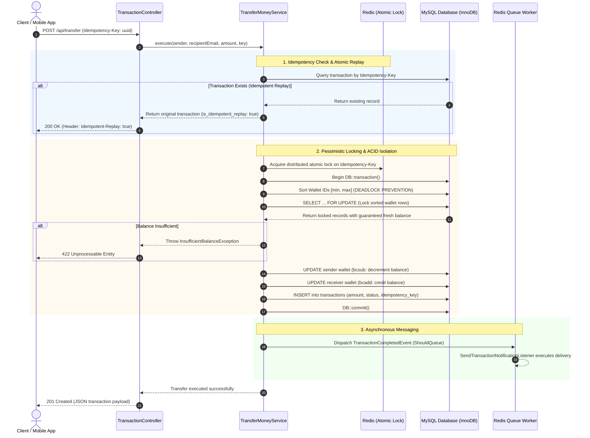

<div align="center">

# 💳 Digital Wallet Core API

**High-Concurrency Financial Ledger & ACID P2P Transfer Engine**

[](https://www.php.net/)
[](https://laravel.com/)
[-4479A1.svg?style=flat-square&logo=mysql&logoColor=white)](https://www.mysql.com/)
[](https://redis.io/)
[](https://www.docker.com/)
[](https://phpunit.de/)
[](https://github.com/neverleans/Wallet-App)
[](LICENSE)

<p align="center">
  <b>Enterprise-grade financial transfer engine engineered to prevent double-spending, eliminate cross-transfer database deadlocks, guarantee strict HTTP idempotency, and maintain arbitrary-precision balance ledgers under high concurrency.</b>
</p>

[🇧🇷 Leia a Documentação em Português](README_PT.md) • [Architecture & Engineering Solutions](#-architecture--concurrency-engineering) • [Transfer Lifecycle Flow](#-transfer-lifecycle-flow) • [API Catalog](#-api-endpoints-reference) • [Docker Quickstart](#-docker-orchestration--quickstart)

</div>

---

## ⚡ Executive Summary & Business Problem

In distributed financial ledger architectures, naive database implementations suffer from catastrophic failure modes under concurrent user loads:

1. **Race Conditions (Double-Spending):** Concurrent debit requests read the same initial balance before decrementing, leading to duplicate payouts and negative balance balances.
2. **Cross-Concurrency Deadlocks:** When User A transfers money to User B at the exact millisecond User B transfers to User A, arbitrary database row locking locks both rows in opposing order, triggering an immediate database deadlock exception (`1213 Deadlock found when trying to get lock`).
3. **Network Retries & Duplicate Charges:** Transient client timeouts or repeated clicks without strict idempotency enforcement lead to duplicate debits.
4. **Binary Floating-Point Drift:** Calculations executed using standard floating-point types (`float`, `double`) introduce fractional precision drift under standard IEEE 754 representation.

---

## 🛡️ Architecture & Concurrency Engineering

The **Digital Wallet Core API** mitigates these failure modes through rigorous engineering patterns:

* **Pessimistic Row Locking (`SELECT ... FOR UPDATE`):** Acquires exclusive row-level database locks on both the sender and receiver wallet records within a dedicated transaction, serializing balance reads and deductions.
* **Deterministic Deadlock Prevention:** Enforces strict ascending order sorting on Wallet IDs (`min(sender_id, receiver_id)`, `max(sender_id, receiver_id)`) before acquiring row locks. This guarantees all concurrent cross-transfers acquire locks in identical sequential order, rendering deadlocks mathematically impossible.
* **HTTP Idempotency Key Gateway (`Idempotency-Key`):** Enforces unique request keys via HTTP headers. Duplicate requests with identical parameters return cached, saved responses (`Idempotent-Replay: true`) with zero balance re-debiting. Divergent payloads reusing the same key trigger immediate `409 Conflict` exceptions.
* **Arbitrary-Precision Arithmetic (`BCMath`):** All ledger credits, debits, and balance comparisons utilize `bcsub`, `bcadd`, and `bccomp` with exact fixed decimal scales, eliminating floating-point rounding errors.
* **Decoupled Clean Architecture:** Strict layered separation utilizing Form Requests (`TransferMoneyRequest`), Core Services (`TransferMoneyService`), Custom Semantic Domain Exceptions, Domain Events (`TransactionCompletedEvent`), and asynchronous Redis queue workers.

---

## 🔄 Transfer Lifecycle Flow



---

## 🏛️ Project Structure

```text
app/
├── DTOs/
├── Events/
│   └── TransactionCompletedEvent.php           # Domain event fired post-DB-commit
├── Exceptions/
│   ├── IdempotencyConflictException.php        # HTTP 409 (Reused key with altered payload)
│   ├── InactiveUserException.php               # HTTP 403 (Account suspended/inactive)
│   ├── InsufficientBalanceException.php        # HTTP 422 (Insufficient funds)
│   ├── SelfTransferException.php               # HTTP 422 (Origin equals destination)
│   └── WalletNotFoundException.php             # HTTP 404 (Unregistered recipient wallet)
├── Http/
│   ├── Controllers/
│   │   ├── Auth/AuthController.php             # Sanctum token authentication
│   │   ├── TransactionController.php           # Lean transfer endpoint controller
│   │   └── WalletController.php                # Atomic wallet balance recharge
│   └── Requests/
│       └── TransferMoneyRequest.php            # Strict schema validation & header extraction
├── Listeners/
│   └── SendTransactionNotificationListener.php # Asynchronous queued email/push worker
├── Models/
│   ├── Transaction.php                         # Transaction model with unique constraint
│   ├── User.php                                # User entity with wallet relationship
│   └── Wallet.php                              # Balance model with decimal casts
└── Services/
    └── TransferMoneyService.php                # Core Engine: ACID, Locks, Deadlock Guard & BCMath
```

---

## 📡 API Endpoints Reference

### 1. Authentication
* **Endpoint:** `POST /api/login`
* **Headers:** `Accept: application/json`, `Content-Type: application/json`

**Request Payload:**
```json
{
  "email": "lucas@example.com",
  "password": "secret_password"
}
```

**Success Response (`200 OK`):**
```json
{
  "message": "Login successful!",
  "token": "1|nO1K...sample_token",
  "user": {
    "id": 1,
    "name": "Lucas Silva",
    "email": "lucas@example.com"
  }
}
```

---

### 2. P2P Financial Transfer
* **Endpoint:** `POST /api/transfer`
* **Headers:**
  * `Authorization: Bearer <TOKEN>`
  * `Accept: application/json`
  * `Content-Type: application/json`
  * `Idempotency-Key: 9b1deb4d-3b7d-4bad-9bdd-2b0d7b3dcb6d` *(UUID v4)*

**Request Payload:**
```json
{
  "recipient_email": "destination@example.com",
  "amount": 250.00
}
```

**First Execution (`201 Created`):**
```json
{
  "message": "Transfer completed successfully!",
  "data": {
    "id": 42,
    "sender_id": 1,
    "receiver_id": 2,
    "amount": "250.00",
    "status": "completed",
    "idempotency_key": "9b1deb4d-3b7d-4bad-9bdd-2b0d7b3dcb6d",
    "created_at": "2026-09-27T15:45:00.000000Z"
  },
  "is_idempotent_replay": false
}
```

**Idempotent Replay (`200 OK` with `Idempotent-Replay: true` header):**
```json
{
  "message": "Transaction retrieved successfully (idempotent replay).",
  "data": {
    "id": 42,
    "sender_id": 1,
    "receiver_id": 2,
    "amount": "250.00",
    "status": "completed",
    "idempotency_key": "9b1deb4d-3b7d-4bad-9bdd-2b0d7b3dcb6d",
    "created_at": "2026-09-27T15:45:00.000000Z"
  },
  "is_idempotent_replay": true
}
```

**Semantic Error Handling:**
* `422 Unprocessable Entity` — Insufficient funds (`INSUFFICIENT_BALANCE`)
* `422 Unprocessable Entity` — Self-transfer blocked (`SELF_TRANSFER_NOT_ALLOWED`)
* `403 Forbidden` — Inactive user account (`INACTIVE_USER`)
* `409 Conflict` — Idempotency key reused with altered payload (`IDEMPOTENCY_CONFLICT`)

---

### 3. Atomic Balance Deposit
* **Endpoint:** `POST /api/wallet`
* **Headers:** `Authorization: Bearer <TOKEN>`, `Accept: application/json`

**Request Payload:**
```json
{
  "amount": 500.00
}
```

---

## 🐳 Docker Orchestration & Quickstart

The project includes an automated, isolated Docker environment:
* **App:** PHP 8.3 CLI with `bcmath`, `pdo_mysql`, `pcntl`, and PECL `redis` extensions.
* **Queue Worker:** Background process listening on Redis queues.
* **MySQL 8.0:** ACID InnoDB relational storage with persistent volume and healthchecks.
* **Redis 7:** In-memory distributed lock manager, cache, and message broker.

### Quick Start
```bash
git clone https://github.com/neverleans/Wallet-App.git
cd Wallet-App
chmod +x setup.sh
./setup.sh
# or via Makefile:
make setup
```

### Makefile Reference

| Command | Action |
|---|---|
| `make up` | Start all Docker containers in background |
| `make down` | Stop and remove running containers |
| `make logs` | Stream real-time web application logs |
| `make queue-logs` | Stream asynchronous notification worker logs |
| `make migrate` | Run database migrations |
| `make fresh-migrate` | Reset database and run seeders |
| `make test` | Execute automated test suite inside container |
| `make shell` | Open interactive shell inside application container |

---

## 🧪 Automated Testing Suite

The test suite exercises all mission-critical concurrency and balance ledger invariants:

1. **Successful P2P Transfer:** Validates exact balance deductions, credits, and ledger entry.
2. **Overdraft Prevention:** Verifies zero-balance transfer attempts fail without database mutations.
3. **Self-Transfer Prohibition:** Rejects self-transfers before database transaction initialization.
4. **Catastrophic Failure Rollback:** Injects forced runtime exceptions midway through execution to prove atomic rollback across all tables.
5. **Idempotency Guarantee:** Dispatches concurrent requests with identical keys, confirming exact single-debit execution.
6. **Payload Tampering Detection:** Confirms key collisions with divergent payloads trigger `409 Conflict`.
7. **Account Suspension Guards:** Ensures inactive senders or receivers cannot participate in transactions.
8. **Boundary Numerical Limits:** Rejects zero, negative, and invalid fractional values.
9. **Event Queue Verification:** Asserts `TransactionCompletedEvent` dispatches to Redis queues.
10. **Atomic Wallet Recharge:** Tests concurrent deposits under pessimistic locking.

```bash
# Run tests locally
php artisan test

# Run tests via Docker
make test
```

---

## 📜 License

Distributed under the **MIT License**. See `LICENSE` for details.

---

<div align="center">
  <b>Engineered with precision by Lucas Ventavele Ribeiro</b><br>
  <a href="https://linkedin.com/in/lucas-ventavele-ribeiro">LinkedIn</a> • <a href="https://neverleans.github.io">Personal Portfolio</a> • <a href="https://github.com/neverleans">GitHub</a>
</div>
